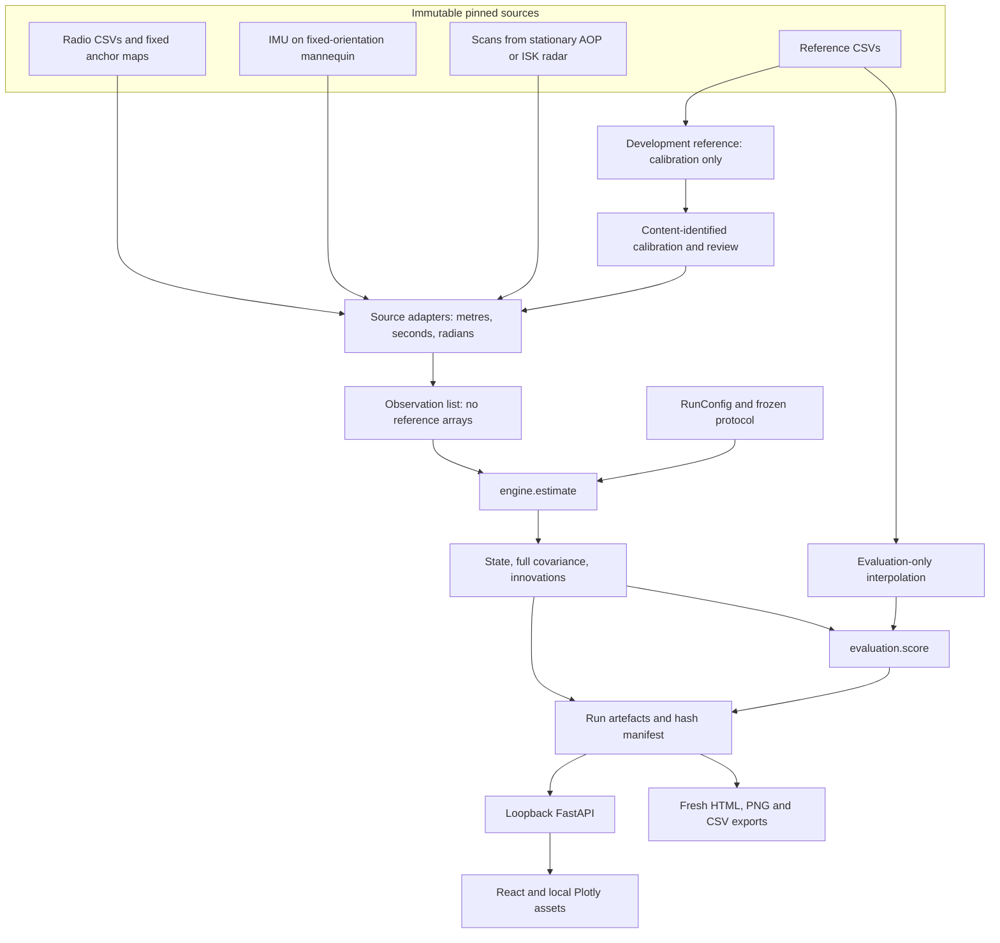
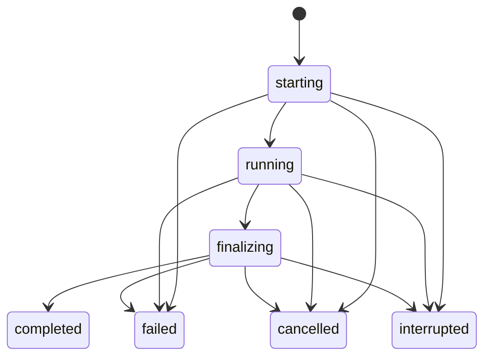

# Architecture

The Python engine is the only estimator. CLI, local API, reports and the React
viewer use the same validated configuration and saved numerical evidence. The
viewer does not infer missing samples, convert raw source units or recompute the
authoritative errors.

## Physical and numerical boundaries

RoboLoc-G uses fixed radio anchors and fixed radars observing a translating gantry
with a mannequin. The estimated point is the gantry origin. Tag mounting offsets
remain in the slant-range observation model. The gantry frame is called `world`
inside the engine; its negative z coordinates are preserved. It is not an
Earth-fixed geodetic frame.

MILUV estimates one physical radio tag. Its evaluator rotates the published tag
lever arm using motion-capture attitude before constructing a reference. This
reference construction does not enter observations.

`contracts.Observation` holds acquisition and arrival time, modality, sensor ID,
value, covariance, anchor/offset, frame and source-row identity. A radio value is a
range, an IMU value is a calibrated acceleration, and a radar value is a 3D
centroid or an N×3 scan cloud. `Session` also holds separate reference arrays.
`engine.estimate(observations, config)` receives only the observation list and
configuration, never `Session` or its reference arrays.

`data.py` applies version-specific schema and frame conversions. Important
examples are RoboLoc-G millimetre UWB/reference values, nanosecond timestamps,
transaction-level FTM duplicate collapse, native radar axes and the strict MILUV
allowlist. Unknown identifiers, contradictory transactions and invalid physical
ranges fail or are explicitly excluded at this boundary. [DATA.md](DATA.md)
records the source evidence and all limitations.

## Engine

`models.py` contains weighted range least squares, range Jacobians, exact CV and
fixed-attitude inertial discretisation, Joseph updates and covariance validation.
`engine.py` selects the method and processes observations in arrival order. A
measurement older than the processed acquisition watermark is rejected as stale.
The previous available acceleration propagates an interval; future acceleration
does not control the past. The regular output grid uses causal predictions.

The first valid UWB solution initialises position. Velocity and residual inertial
bias start at zero with explicit covariance. Expired ranges and rank-deficient
geometry produce unavailable WLS estimates. Covariance failures fail a run; the
filter does not clip its covariance eigenvalues to hide a numerical problem.

`radar.py` removes exactly repeated returns, clusters each scan and uses the
causal prediction to require one unique association. One scan supplies at most
one centroid with the calibrated full 3×3 residual covariance. Return count does
not divide that covariance. The effective transform includes a possible fixed
scattering-centroid offset and is not a separately identified physical radar pose.

M7 and M8 gate using NIS and a chi-square threshold for the actual observation
dimension. Rejected innovations are retained. There is no automatic reset after
gating lockout. [DERIVATIONS.md](DERIVATIONS.md) gives equations, units, initial
covariances and the independent numerical reference checks.

## Calibration and frozen studies

Primary calibration uses only `still`, `zigzag1` and `zigzag2`. Parameter selection
uses `zigzag3`, `zigzag4` and `random1`. `circle` and `random2` can execute only
through a registered frozen study. The external split is MILUV session
`default_1_random3_0` for calibration/selection and `default_1_random3_2` for the
protected check, limited to M1/M2.

Calibration records have content-derived IDs and source archive hashes. Radar
annotation selection reserves 20 fit and 10 check scans per radar; the fit-only
search cannot use check truth to choose clustering or the transform. An explicit
independent agent review binds the candidate calibration and annotation manifest
hashes. Accepting review creates a new record and retains its parent. The current
primary record is `roboloc-g-development-9cd4f70009fc`, and the external record is
`miluv-development-f074bca2f3f1`. `certified` means the declared engineering
admission gates passed. It does not mean human scientific review or independent
reproduction has occurred.

`study.select_parameters` saves all declared candidates, development WLS-window
availability and validation objectives. `freeze_study` records resolved settings,
calibration hash, selection hash, protocol hash and the scientific source hash.
`freeze_external_study` performs the external development-only selection before
freezing its M1/M2 settings. Scientific source hashing covers the Python modules
in `src/sensorfusion/`; a source change invalidates the existing freeze.

`verify_study` checks both protocol copies, calibration and source. Protected
admission permits only the selected settings and predeclared radar/fault
variations. Each matrix attempt is reserved before execution and has a unique
run ID. Failures remain in the ledger, and a failed/unscoreable primary trajectory
leaves its macro-average headline null. A completed frozen study cannot be
silently overwritten or extended through another final evaluation.

## Execution and evidence lifecycle

`runtime.ExperimentRuns` starts one spawned numerical worker. A workspace-wide
`FileLock` coordinates workers across API instances and CLI commands. Admission
uses a readiness handshake; a busy workspace returns HTTP 409. Process ID plus
creation time identifies workers, so PID reuse does not make an orphan appear
alive. Missing workers leave interrupted statuses on reconciliation.

Cancellation sets an event checked by the worker and finalisation path. A
cancellation request is not a completed cancellation until the saved run says so.
API shutdown first requests cancellation, then stops an unresponsive worker and
records interruption. Failed, cancelled and interrupted runs do not expose
completed numerical evidence through the API.

| Location | Content |
| --- | --- |
| `workspace/data/raw/{dataset}/` | Pinned compressed source archives |
| `workspace/data/access/`, `workspace/data/audits/` | Retrieval, checksum and actual-schema evidence |
| `workspace/data/annotations/` | Development radar scan manifests and review panels |
| `workspace/calibrations/` | Immutable content-identified observation calibrations |
| `workspace/selection/` | Candidate settings and completed selection record |
| `workspace/runs/{run_id}/` | Status, config, provenance, numerical HDF5, diagnostics, metrics, reports and manifest |
| `workspace/studies/{study_id}/` | Frozen protocol, ledger and results |
| `workspace/exports/` | Fresh report regenerations outside completed run evidence |

JSON writes and the numerical HDF5 publish via temporary files. The run becomes
`completed` only after numerical artefacts, reports and a SHA-256 manifest exist.
`numerical.h5` stores times, full states/covariances, aligned reference, saved
errors and anchors. Pre-gating innovations and radar frames are separate JSON.
Provenance includes configuration/calibration/protocol/source hashes, archive
hashes for recorded data, dependency versions, platform and synthetic/fault labels.

`reporting.generate_report` can generate an in-progress run's initial report or
write to a fresh export directory. It refuses to rewrite a completed run in place.
API downloads admit only manifest-registered filenames and check their saved
SHA-256 before returning bytes.

## Local interface

`cli.py` is a thin boundary for data access, calibration, experiments, selection,
freeze, study execution, exports and serving. The default workspace is relative
to the invoking directory. `--workspace` precedes the subcommand.

`api.create_app` binds through Uvicorn to `127.0.0.1`, normally port 8766. It uses
trusted hosts, same-origin checks for mutations and registered IDs rather than
arbitrary user paths. It is a local application, with no remote deployment or
authentication claim.

| Route | Contract |
| --- | --- |
| `GET /api/health`, `GET /api/catalog` | Version/workspace and authoritative defaults, readiness, units and methods |
| `POST /api/config/resolve` | Validate and resolve a `RunConfig` |
| `GET /api/runs`, `POST /api/runs` | Saved run inventory and one-worker admission |
| `GET /api/runs/{id}`, `POST /api/runs/{id}/cancel` | Saved lifecycle status and cooperative cancellation request |
| `GET /api/runs/{id}/trajectory?max_points=2000` | Decimated saved trajectory, null rows, full position covariance and confidence geometry |
| `GET /api/runs/{id}/diagnostics?max_points=2000` | Saved innovations, including rejections, with explicit decimation metadata |
| `GET /api/runs/{id}/radar-frame?time=0` | Nearest saved frame for the run's selected radar |
| `GET /api/runs/{id}/artifacts`, `GET /api/runs/{id}/artifacts/{artifact_id}` | Registered manifest and hash-checked download |
| `GET /api/studies`, `GET /api/studies/{id}` | Declared protocol, blockers and saved study record |

The UI lives in `frontend/src/`. `Datasets`, `Experiment`, `Replay`, `Comparison`
and `Study` are the five views. Selection and the shared cursor live in URL
parameters. Stale requests are discarded. Comparison checks nested calibration,
scientific fingerprints and physical settings, so an apparent pair cannot conceal
a mismatched protocol.

The backend constructs nominal 95% axes from the full 3D position covariance and
the three-degree-of-freedom chi-square quantile. XY and XZ use their own 2D
marginal covariance and two-degree-of-freedom quantile. The viewer renders those
separate geometries. Reference gaps, unavailable estimates and saved errors retain
their original row alignment. Metrics use the full eligible saved data, even when
plots are decimated.

## Acceptance evidence

The most direct executable boundaries are `tests/test_models.py` for independent
mathematics, `test_engine.py` for causality/gating, `test_data.py` for actual schema
adapters and calibration isolation, `test_study.py` for freeze admission/failure
ledgers, and `test_integrity.py` for worker/report integrity. Browser workflows in
`frontend/tests/workbench.spec.ts` exercise the real local API and explicitly
constructed missing-data/error cases. Commands and actual platform outcomes are
recorded in REPRODUCING.md (not included in this source-only snapshot). Their passing fixtures cannot replace
the protected recorded-data study or external human deliverables.
